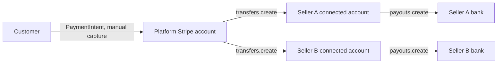

A Mercur marketplace talks to Stripe through one plugin, `@mercurjs/stripe-connector-plugin`, that ships **two providers**: a Medusa payment provider that charges customers at checkout on the platform account, and a Mercur payout provider that moves money to sellers' Stripe Connect accounts and pays it out to their banks.

Mercur's core payout module keeps the seller's payout account, one payout per order, and the reversals of refunds, and it talks to one payout provider. The plugin brings that provider for Stripe Connect, plus everything Stripe-specific around it: the scheduled jobs that decide when to capture, pay out, and reverse, the settlements and bank payouts, operator adjustments, and the admin and vendor screens.

<Tip>
  This page is the configuration reference. For the core payout models and workflows the plugin drives, see the [Payout](/platform/payout/overview) module.
</Tip>

<Info>
  Mercur uses the aggregate payment model: the platform account charges the whole cart once, holds the authorization until every seller order in the group is decided, and then transfers each seller's share with `source_transaction` set to that charge. The platform is the **Merchant of Record**.
</Info>

## Prerequisites

- A [Stripe account](https://dashboard.stripe.com) with Connect enabled
- Stripe secret API key and publishable API key
- A running Mercur project ([installation guide](/learn/introduction))
- Node.js 22.22+

## Architecture overview



| Integration | Provider id | Purpose | Webhook endpoint |
|---|---|---|---|
| Customer payments | `pp_stripe-connector_stripe` | Authorizes and captures the cart on the platform account | `/hooks/payment/pp_stripe-connector_stripe` |
| Seller payouts | `pop_stripe-connect_stripe` | Express accounts, onboarding, payouts as transfers, reversals | `/hooks/payout` |

## Stripe Dashboard setup

<Steps>
  <Step title="Enable Connect">
    In your Stripe Dashboard, go to **Settings → Connect settings** and enable Connect.
  </Step>
  <Step title="Find your API keys">
    Go to **Developers → API keys**. You need the secret key (`sk_test_` or `sk_live_`) and the publishable key.
  </Step>
  <Step title="Set environment variables">
    ```bash
    STRIPE_SECRET_KEY=sk_test_...
    STRIPE_OPERATOR_WEBHOOK_SECRET=whsec_...   # platform account webhook
    STRIPE_SELLERS_WEBHOOK_SECRET=whsec_...    # Connect (connected accounts) webhook
    BACKEND_URL=https://api.example.com
    VENDOR_URL=https://vendor.example.com
    ```
  </Step>
</Steps>

## Install the plugin

```bash
bun add @mercurjs/stripe-connector-plugin
```

```ts
// medusa-config.ts
module.exports = withMercur({
  plugins: [
    {
      resolve: "@mercurjs/stripe-connector-plugin",
      options: {
        apiKey: process.env.STRIPE_SECRET_KEY,
        webhookSecret: process.env.STRIPE_SELLERS_WEBHOOK_SECRET,
        settlements: { mode: "plugin" },
        alerting: {
          technicalEmail: "ops@example.com",
          from: "noreply@example.com",
        },
      },
    },
  ],
  modules: [
    {
      resolve: "@medusajs/medusa/payment",
      options: {
        providers: [
          {
            resolve: "@mercurjs/stripe-connector-plugin/providers/payment-stripe",
            id: "stripe",
            options: {
              apiKey: process.env.STRIPE_SECRET_KEY,
              webhookSecret: process.env.STRIPE_OPERATOR_WEBHOOK_SECRET,
            },
          },
        ],
      },
    },
    {
      resolve: "@mercurjs/core/modules/payout",
      options: {
        providers: [
          {
            resolve: "@mercurjs/stripe-connector-plugin/providers/payout-stripe-connect",
            id: "stripe",
            options: {
              apiKey: process.env.STRIPE_SECRET_KEY,
              webhookSecret: process.env.STRIPE_SELLERS_WEBHOOK_SECRET,
              manualPayouts: true,
            },
          },
        ],
        onboarding: {
          returnUrl: `${process.env.VENDOR_URL}/stripe`,
          refreshBaseUrl: process.env.BACKEND_URL,
        },
      },
    },
  ],
})
```

The payout module takes exactly one provider. Run `medusa db:migrate` afterwards, which also creates the plugin's `stripe_connector` tables, then enable Stripe as a payment method in the Admin Panel: **Settings → Regions → Edit region → Payment providers**.

### Payment provider options

| Option | Type | Description |
|--------|------|-------------|
| `apiKey` | `string` | Stripe secret API key |
| `webhookSecret` | `string` | Signing secret of the platform-account webhook |
| `automaticPaymentMethods` | `boolean` | Enable Stripe's automatic payment method detection |
| `paymentDescription` | `string` | Description shown on the customer's statement |
| `orderGroupMetadataKey` | `string` | Metadata key carrying the order group id on the PaymentIntent (default `mercur_order_group_id`) |

Capture is always manual; the plugin's capture job decides when to capture.

### Payout provider options

| Option | Type | Default | Description |
|--------|------|---------|-------------|
| `apiKey` | `string` | - | Stripe secret API key |
| `webhookSecret` | `string` | - | Signing secret of the Connect webhook |
| `manualPayouts` | `boolean` | `false` | Put new connected accounts on a manual payout schedule, so the plugin's settlements pay them out. Pair with `settlements.mode: "plugin"` |
| `accountValidation` | `object` | see below | When a connected account counts as `active` |

| Validation option | Type | Default | Description |
|--------|------|---------|-------------|
| `detailsSubmitted` | `boolean` | `true` | Require onboarding details to be submitted |
| `chargesEnabled` | `boolean` | `true` | Require charges to be enabled |
| `payoutsEnabled` | `boolean` | `true` | Require payouts to be enabled |
| `noOutstandingRequirements` | `boolean` | `true` | Treat outstanding requirements as restricted |
| `requiredCapabilities` | `string[]` | `[]` | Capabilities that must be `active` |

### Payout module options

These belong to `@mercurjs/core/modules/payout` and apply to any provider.

| Option | Default | Description |
|--------|---------|-------------|
| `onboarding.returnUrl` | - | Where Stripe sends the seller after onboarding (the vendor Stripe page) |
| `onboarding.refreshBaseUrl` | - | Your API origin; the refresh URL is `<base>/payout/onboarding/refresh?token=` |
| `onboarding.prefill` | `false` | Prefill the Express account's business profile from the seller |
| `onboarding.defaultCountry` | - | Country used when the seller has no address |

### Plugin options

These go on the plugin entry under `plugins`. Every option is typed by `StripeConnectorPluginOptions`.

| Option | Default | Description |
|--------|---------|-------------|
| `apiKey` | - | Platform secret key, used for settlement bank payouts and adjustments |
| `webhookSecret` | - | Signing secret of the Connect webhook, used to read bank payout events |
| `onboarding.enabled` | `true` | Create accounts and publish onboarding links automatically |
| `capture.captureBeforeAcceptance` | `false` | Capture as soon as no order is awaiting acceptance instead of waiting for fulfillment |
| `capture.authorizationWindowMs` | 7 days | How long the authorization stays valid |
| `capture.safetyBufferMs` | 24 hours | Capture what is decided this long before expiry |
| `transfers.enabled` | `true` | Run the payout job |
| `transfers.requiredFulfillmentStatus` | `"fulfilled"` | Minimum fulfillment status before an order is paid out |
| `reversals.enabled` | `true` | Run the reversal job |
| `settlements.enabled` | `true` | Run the settlement job |
| `settlements.mode` | `"plugin"` | `plugin` nets each window and sends the bank payout from the plugin (pair with `manualPayouts: true`); `provider` records settlements and lets Stripe's schedule pay |
| `notifications.url` | - | URL that receives a JSON POST for every failed payout, reversal or bank payout and every account update |
| `notifications.secret` | - | Signs each notification: the HMAC-SHA256 of the raw body, hex-encoded, in an `x-mercur-signature: sha256=<hex>` header. The admin screens only ever show the URL's origin |
| `notifications.mailOnEndpointDown` | `true` | Email when that URL keeps failing |
| `notifications.endpointDownCooldownMinutes` | `10` | Minimum time between two such emails |
| `alerting.technicalEmail` | - | Recipient of the daily failed-operations digest |
| `alerting.from` | - | Sender of the alert emails |
| `kycMonitor.enabled` | `false` | Run the KYC monitor job |

## Set up webhooks

Create two endpoints under **Developers → Webhooks**:

| Endpoint | Listen to | Events |
|---|---|---|
| `https://api.example.com/hooks/payment/pp_stripe-connector_stripe` | Your account | `payment_intent.succeeded`, `payment_intent.amount_capturable_updated`, `payment_intent.payment_failed`, `payment_intent.canceled`, `charge.refunded` |
| `https://api.example.com/hooks/payout` | Connected accounts | `account.updated`, `transfer.created`, `transfer.reversed`, `payout.paid`, `payout.failed`, `payout.canceled`, `payout.updated` |

The admin page **Settings → Stripe** prints both URLs for your deployment. Core's `payout-webhook` subscriber handles the account and transfer events; the plugin's own subscriber on the same event applies the bank `payout.*` events to its settlements.

## The schedule

The jobs ship in the plugin, not in `@mercurjs/core`. The payout and reversal jobs call core's `createOrderPayoutsWorkflow` and `createPayoutReversalsWorkflow`; the plugin adds the backlog, the checkpoints, and the run records around them.

| Job | Schedule (UTC) | What it does |
|---|---|---|
| `payout-sync-onboarding` | every minute | Sellers created or updated since the checkpoint get an Express account, and an onboarding link until they finish onboarding |
| `payout-validate-captures` | every 5 minutes | Captures the cart payment once every seller order in the group is canceled or fulfilled, for the authorized amount minus canceled orders; cancels it when nothing is left |
| `payout-process-transfers` | every 5 minutes, minute 1 | Re-decides the backlog of failed and held payouts, then pays total minus commission for each newly fulfilled and captured order, skipping paused sellers |
| `payout-process-reversals` | every 5 minutes, minute 2 | Reverses the seller's share of every refund, net of commission |
| `payout-process-settlements` | daily at 01:03 | Retries failed bank payouts, sends adjustments, builds one settlement per seller and currency over the window since the last one, and pays it out |
| `payout-alert-failed-operations` | daily at 08:04 | Emails the technical contact everything still failed |
| `payout-monitor-kyc` | every 6 hours, opt-in | Re-reads every account's requirements and KYC status |

Every job writes a run record you can read under **Finance → Stripe** in the admin, where each tab has a "Run now" button and a run history. The plugin also runs the payout and reversal passes right away when an order is fulfilled or canceled, a payment is captured, or a refund is made. Its routes live under `/admin/stripe/*` and `/vendor/stripe/*`.

## How money moves

1. **Checkout.** The platform account creates a PaymentIntent for the whole cart with manual capture. Mercur splits the cart into seller orders and writes commission lines.
2. **Capture.** When every seller order is decided, the capture job captures the authorized amount minus canceled orders. Medusa's split then gives each order its own captured payment on the same charge.
3. **Payout.** Once an order is fulfilled and captured, core writes one `payout` for it and the provider's `createPayout` calls `transfers.create`, moving total minus commission to the seller's account with the charge as `source_transaction`.
4. **Reversal.** A refund on the order writes a `payout_reversal`, and `reversePayout` reverses the seller's share of it on the original transfer.
5. **Adjustments.** Operators can enter subscription fees, extra invoices and credits under **Finance → Stripe → Settlements**; the plugin sends them as debits or credits on the next run.
6. **Settlement and bank payout.** Every night the settlement job nets the paid payouts, reversals and adjustments since the previous settlement into a settlement, and in `plugin` mode calls `payouts.create` on the connected account in the settlement currency. When the available balance in that currency is short, the bank payout is held (`insufficient_available_balance`) and retried on the next run.
7. **Webhooks.** `account.updated` re-syncs the account; bank `payout.*` events update the settlement and feed the alert digest.

Payouts and reversals use core's statuses `pending`, `on_hold`, `processing`, `paid`, `failed`, `aborted`, each with a human-readable reason. Failed and held rows are retried from the backlog on every run.

## Seller onboarding

Sellers see their payout account on the vendor panel's **Payouts** page: its status, whether payouts are enabled, the verification status, and an action to continue onboarding (with a fresh link when the old one expires) or, once onboarding is done, to open the provider dashboard. The plugin adds a **Stripe** page under **Integrations** in the vendor sidebar. Before an account exists, sellers pick a country and business type there; the onboarding job can also create the account on its own. Afterwards the page shows the Stripe account id, card payments, what Stripe still needs from the seller, and the settlements that net their payouts and refunds per period with the bank payout that paid them.

Operators see the same account on the seller page, and can map an existing Stripe account, refresh links, sync from Stripe, or pause a seller's payouts under **Finance → Stripe → Onboarding**. Pausing sets `payout_ignored` on the seller's metadata, and the payout job skips that seller's orders.

## Testing

Use test-mode keys and forward both webhooks with the Stripe CLI:

```bash
stripe listen --forward-to localhost:9000/hooks/payment/pp_stripe-connector_stripe
stripe listen --forward-connect-to localhost:9000/hooks/payout
```

Then register a seller, finish Express onboarding with Stripe's test data, place a two-seller order, fulfil both orders, and run each job from the admin tabs. The transfers, reversals and bank payouts appear in the Stripe test dashboard.

## Next steps

- [Payout module](/platform/payout/overview)
- [Configuration reference](/references/configuration)
