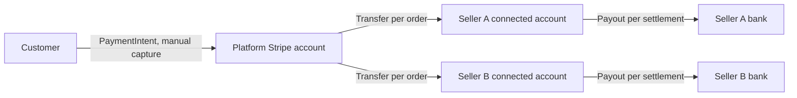

The integration has three layers. Stripe holds the money and the connected accounts. Mercur core's payout module records what each seller is owed per order. The Stripe connector plugin decides when each step runs and adds everything that is Stripe-specific.

## What runs where

| Layer | Package | Owns |
| --- | --- | --- |
| Payment provider | `@mercurjs/stripe-connector-plugin/providers/payment-stripe` | The PaymentIntent for the whole cart on the platform account, with manual capture, and its refunds |
| Payout provider | `@mercurjs/stripe-connector-plugin/providers/payout-stripe-connect` | Express accounts, onboarding and login links, a Transfer per payout, a Transfer reversal per refund, and Connect webhooks |
| Payout module | `@mercurjs/core/modules/payout` | `payout_account`, its `onboarding` link, one `payout` per seller order and one `payout_reversal` per later refund, with their statuses |
| Plugin module | `stripe_connector` | Captures, settlements and their lines, adjustments, job runs, checkpoints and the notification log |
| Plugin jobs and subscribers | `@mercurjs/stripe-connector-plugin` | When to capture, pay out, reverse and settle |
| Plugin screens | `@mercurjs/stripe-connector-plugin/admin`, `/vendor` | **Integrations → Stripe** and **Settings → Stripe** in the admin, widgets on the order and payout account pages, and the vendor **Stripe** page |

Core ships no schedule. Its workflows, `createOrderPayoutsWorkflow` and `createPayoutReversalsWorkflow`, decide and send whatever they're called with. The plugin's jobs and subscribers call them, and add the backlog, checkpoints and run records around them.

## Stripe objects

| Mercur record | Stripe object | Created by | On |
| --- | --- | --- | --- |
| Payment on the order group | PaymentIntent with `capture_method: manual` | Payment provider | The platform account |
| `payout_account` | Express Account | Payout provider | The platform account |
| `onboarding` | Account Link (onboarding) or Login Link | Payout provider | The connected account |
| `payout` | Transfer with `source_transaction` set to the charge | Payout provider | The platform account, to the connected account |
| `payout_reversal` | Transfer reversal | Payout provider | The original Transfer |
| Adjustment credit | Transfer | Plugin | The platform account, to the connected account |
| Adjustment debit | Transfer from the connected account | Plugin | The connected account, to the platform |
| Settlement | Payout | Plugin | The connected account, to its bank |

Every call that moves money carries an idempotency key built from the Mercur record id and its attempt number, so a job that resends the same attempt never moves money twice.

Transfers use `source_transaction`, so a payout can be sent as soon as the charge is captured, even while the funds are still pending on the platform balance.

## Anatomy of an order

A customer buys from two sellers in one cart, and pays once.

1. **Checkout.** The payment provider creates one PaymentIntent for the cart with manual capture. The card is authorized, not charged. Mercur splits the cart into an order group with one order per seller and writes commission lines. The plugin opens a **capture** for the order group.
2. **Orders are decided.** Each seller fulfills or cancels their order. Every fulfillment and cancellation refreshes the capture.
3. **Capture.** Once every order is decided, the capture job captures the authorized amount minus canceled orders. If every order was canceled, it cancels the authorization instead. Medusa then gives each seller order its own captured payment on the same charge.
4. **Payout.** The capture runs the payout pass. For each fulfilled, captured order, core writes a `payout` of the order total minus commission, net of refunds that already landed, and the provider sends it as a Transfer.
5. **Refund.** A refund on a paid order writes a `payout_reversal` of the seller's share, net of its commission share, and the provider reverses that much of the Transfer.
6. **Settlement.** Every night the settlement job nets the seller's paid payouts, reversals and adjustments since the previous settlement, per currency, and sends the total to the seller's bank as a Stripe Payout.
7. **Webhooks.** `account.updated` keeps the payout account in step with Stripe. Bank `payout.*` events move the settlement to **Paid out** or **Failed**.

## When each step runs

Every step runs from a scheduled job, so nothing is lost if an event is missed. Most also run right away from a subscriber, so sellers don't wait for the next tick.

| Trigger | Runs |
| --- | --- |
| Order group created | Opens the group's capture |
| Order fulfilled or canceled | Refreshes the group's capture, then the order's payout pass |
| Payment captured | The payout pass for the captured orders |
| Refund created | The reversal pass for the order |
| Payout account becomes active | Queues the seller's orders that were waiting for an account, for the next payout run |
| Stripe `account.updated` | Syncs the payout account |
| Stripe `payout.*` | Updates the settlement's bank payout |

The scheduled jobs and their default times are listed in the [reference](/resources/integrations/stripe-connect/reference#scheduled-jobs).

## Job runs and checkpoints

Every run of every job, whether scheduled, started with **Run now** or started by a subscriber, writes a **job run** with its trigger, its status and counts of what it did. A job that is already running isn't started twice.

Jobs that scan for new work keep a **checkpoint**, the timestamp they last read up to, so each run reads only what changed. A job that fails leaves its checkpoint where it was and reads the same window again next time.

Jobs that act on many sellers or orders run one workflow per item. A seller whose account Stripe rejects is recorded as failed, and the rest go through.

## Settlement modes

`settlements.mode` decides who sends the bank payout:

| Mode | Bank payout sent by | Connected accounts | Settlement records |
| --- | --- | --- | --- |
| `plugin` (default) | The plugin, as one Stripe Payout per settlement | Manual payout schedule, with `manualPayouts: true` on the payout provider | Open until Stripe confirms the bank payout |
| `provider` | Stripe, on the account's automatic payout schedule | Stripe's default schedule | Recorded as paid out, for the seller's statement only |

Use `plugin` when you want one deposit per period that matches the seller's statement to the cent. Use `provider` when you prefer Stripe's daily or weekly schedule and only need the netting for reporting.
